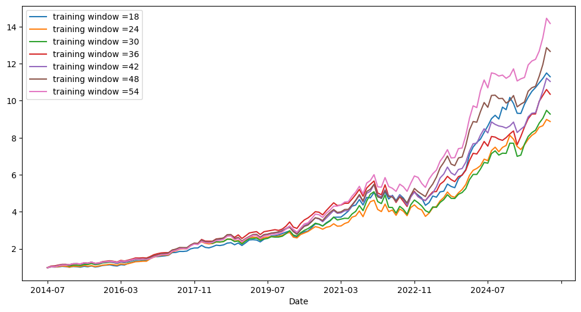
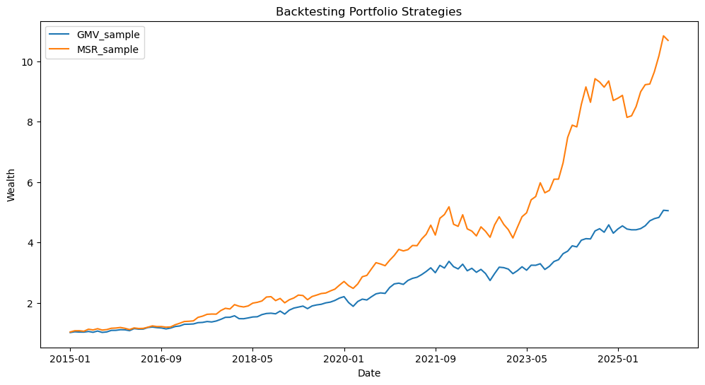
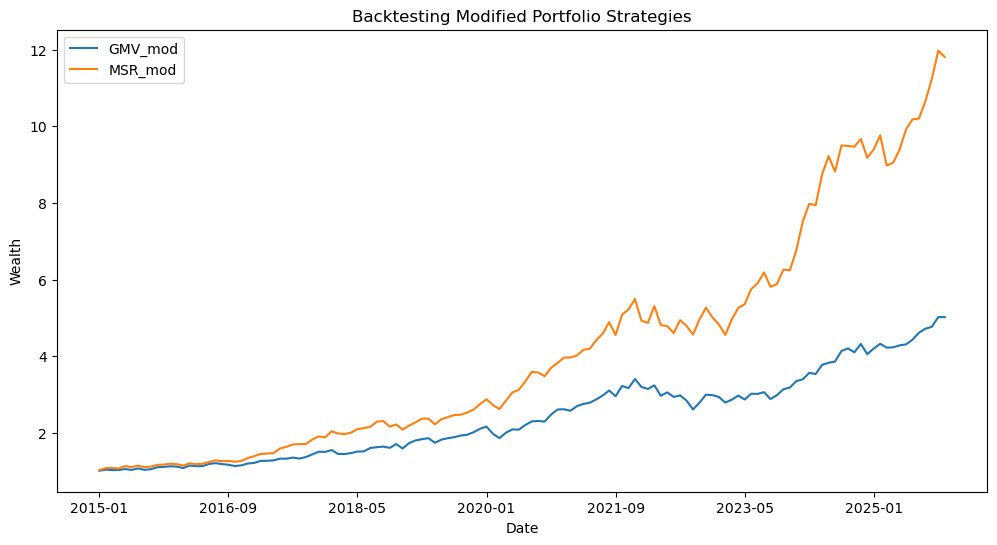
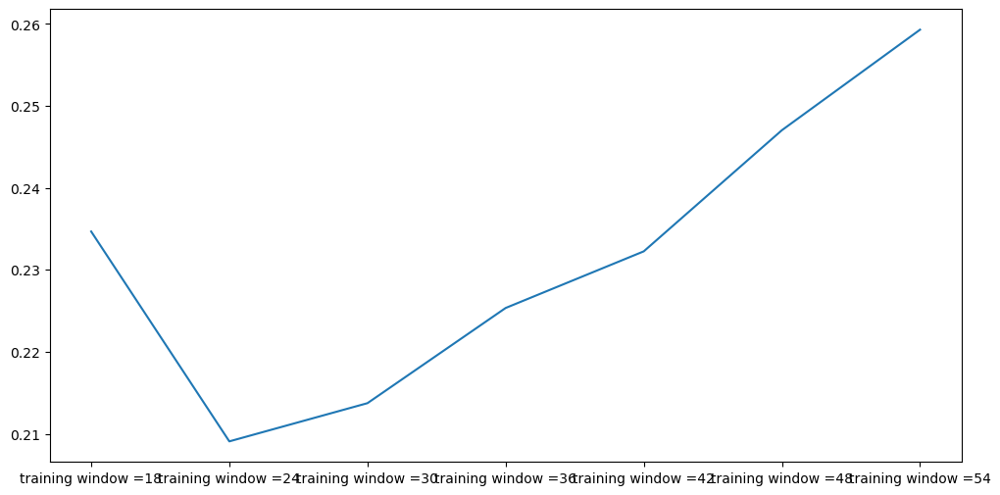

# Portfolio Construction & Sector-Constrained Optimization (`pyfin`)

Empirical study and reusable Python quantitative finance library (`pyfin`) evaluating **Global Minimum Variance (GMV)** and **Maximum Sharpe Ratio (MSR)** portfolio construction across a screened universe of 50 US large-cap equities.

## Key Research Problem & Solution
Unconstrained mean-variance optimization treats sample estimates of expected returns ($\mu$) and covariance ($\Omega$) as true parameters, overfitting to estimation noise and producing extreme corner solutions (**66.07% allocation concentrated in just two defensive sectors**—Consumer and Utilities—in the baseline GMV portfolio).

To regularize estimation risk while preserving risk-adjusted return efficiency, this framework enforces a **25% maximum sector allocation constraint** (`GMV_mod`, `MSR_mod`) and evaluates out-of-sample performance using a **rolling 60-month estimation window** against an investable **Equal-Weighted ($1/N$) benchmark** (`EW`).

---

## Out-of-Sample Empirical Results

| Strategy | Annualized Return | Annualized Volatility | Max Drawdown | 5% Monthly VaR | 5% Monthly CVaR | Sharpe Ratio ($r_f = 3\%$) |
| :--- | :---: | :---: | :---: | :---: | :---: | :---: |
| **Sector-Constrained MSR (`MSR_mod`)** | **25.16%** | 15.34% | **-17.03%** | 6.09% | 7.62% | **1.357** |
| **Sector-Constrained GMV (`GMV_mod`)** | 15.80% | **13.03%** | -23.35% | **6.09%** | **7.33%** | 0.967 |
| **Equal-Weighted Benchmark (`EW`)** | 16.93% | 15.04% | -19.72% | 6.37% | 8.75% | 0.922 |

### Multi-Factor Alpha Attribution (`MSR_mod` vs. `EW`)

| Strategy | Factor Model | Monthly Alpha | Annualized Alpha | $t$-Statistic | $R^2$ |
| :--- | :--- | :---: | :---: | :---: | :---: |
| **`MSR_mod`** | CAPM (`Mkt-RF`) | +1.07% | **+12.82%** | 3.96 | 0.548 |
| **`MSR_mod`** | Fama-French 3-Factor (`FF3`) | +0.87% | **+10.45%** | 3.79 | 0.685 |
| **`MSR_mod`** | Carhart 4-Factor (`FF3 + Mom`) | +0.74% | **+8.86%** | 3.64 | 0.759 |
| **`EW`** | Carhart 4-Factor (`FF3 + Mom`) | +0.29% | +3.45% | 3.37 | 0.957 |

---

## Visual Highlights

### Out-of-Sample Cumulative Wealth Growth


### Baseline Unconstrained vs. 25% Sector-Constrained Allocations
| Baseline Unconstrained Sector Weights | 25% Sector-Capped Allocations |
| :---: | :---: |
|  |  |

### Parameter Robustness Across Rolling Estimation Windows


---

## Repository Structure

```text
├── portfolio_optimization.ipynb   # Full empirical analysis, rolling backtests & factor regressions
├── pyfin/                         # Modular quantitative finance package
│   ├── portfolio.py               # GMV, MSR, target-return optimizers & efficient frontier
│   ├── backtest.py                # Rolling-window out-of-sample strategy engine
│   ├── risk.py                    # Annualized return/vol, Sharpe, drawdown, VaR & CVaR
│   ├── analytics.py               # Institutional performance tear-sheet generator
│   ├── options.py                 # Black-Scholes & implied volatility solvers
│   └── data.py                    # Fama-French & momentum factor loader
├── assets/                        # Extracted empirical charts
└── requirements.txt
```

## Tech Stack
- **Python:** `numpy`, `pandas`, `scipy.optimize`, `statsmodels`, `matplotlib`, `yfinance`
